# Running Example

For `PX_RCFS_P1`, RVat derives slicing criteria from the Policy–TCTL correspondence and uses them to extract a function-level slice. It then converts the slice into a timed control flow automaton (TCFA) before adding time constraints.

## From the Policy–TCTL correspondence to slicing criteria

**Policy.** As long as the physical radio control (RC) link remains healthy, the drone should not enter RC failsafe solely because the update interval of `manual_control_setpoint` exceeds `COM_RC_LOSS_T`.

The corresponding TCTL formula is written in UPPAAL syntax.

```text
A[] ((rc_link_ok && rc_update_time > COM_RC_LOSS_T) imply !rc_loss_failsafe)
```

The formula requires that rc_loss_failsafe be false in every reachable state where the physical link is healthy and the RC update interval exceeds the threshold.
To derive slicing criteria, RVat uses retrieval-augmented generation (RAG) to retrieve function definitions relevant to the policy and propose mappings from the formula to source code.
Each criterion is a pair \((var, loc)\) that identifies a program variable or expression and its source location.
[Table 1](#table-1) maps the formula variables to the slicing criteria.

<a id="table-1"></a>

**Table 1. Mapping from formula variables to slicing criteria**

| Formula variable | Slicing criterion `(var, loc)` |
|---|---|
| `COM_RC_LOSS_T` | (`_param_com_rc_loss_t.get()`, `rcAndDataLinkCheck.cpp:50`) |
| `rc_loss_failsafe` | (`reporter.failsafeFlags().manual_control_signal_lost`, `rcAndDataLinkCheck.cpp:58`) |

The model treats `rc_link_ok` as an environmental assumption that the physical RC link remains healthy. `rc_update_time` denotes the elapsed time since the latest `manual_control_setpoint` update.

## From slicing criteria to a function-level slice

RVat constructs the program dependence graph (PDG) of the entire autopilot with LLVM-PDG and uses MLTA to refine the resolution of indirect and virtual calls in LLVM IR.
[Figure 1](#figure-1) shows the part of the PDG needed to explain the slice.
It expands the dependencies within `RcAndDataLinkChecks::checkAndReport()` and summarizes the caller, `HealthAndArmingChecks::update()`, in a single node.
The edges that bind the actual arguments at the call site to the callee's parameters remain visible.

<a id="figure-1"></a>

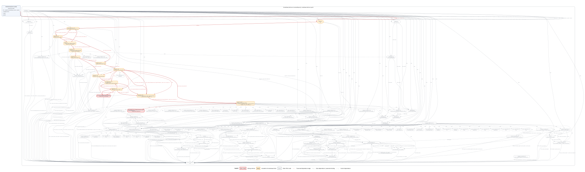

*Figure 1. Program dependence graph and backward slicing for PX_RCFS_P1.*

The two criteria (`_param_com_rc_loss_t.get()`, `rcAndDataLinkCheck.cpp:50`) and (`reporter.failsafeFlags().manual_control_signal_lost`, `rcAndDataLinkCheck.cpp:58`) map to the red boxes labeled SC1 and SC2, respectively. These two PDG nodes form $S_p=\{\mathrm{SC1},\mathrm{SC2}\}$.
RVat traverses the data and control dependence edges backward from $S_p$ and adds the nodes that affect the starting nodes to the slice. 
In [Figure 1](#figure-1), orange nodes and red edges show the traversal. 
Solid edges indicate data dependences or parameter bindings, and dashed edges indicate control dependences. 
When the traversal reaches the `this` parameter of `checkAndReport()`, it continues back to `HealthAndArmingChecks::update()` through the parameter binding at the call site.

RVat collects the functions that contain these nodes and the relevant call relationships to obtain the function-level slice $F$, with `HealthAndArmingChecks::update()` as its entry function $e_F$. 
The slice serves as input to TCFA construction.

## From the slice to a time-unspecified TCFA

### Control flow graph normalization

RVat normalizes each function's control flow graph (CFG) by consolidating its return points into a single exit basic block. 
In [Figure 2](#figure-2), the two original paths return `true` and `false`, respectively.
After normalization, each path assigns its value to `ret` and flows into the common block that executes `return ret`. This gives the inlining step a single exit to reconnect to the caller.

<a id="figure-2"></a>

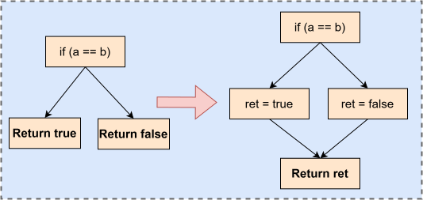

*Figure 2. Return unification.*

RVat expands each indirect call into explicit branches using the candidate targets resolved by MLTA. 
In [Figure 3](#figure-3), RVat replaces the indirect call `r = fp(args)` with conditional branches that compare the function pointer `fp` with each candidate function's address in turn. 
If `fp` matches the address of `func_i`, the corresponding branch executes the direct call `r = func_i(args)`. 
Otherwise, execution proceeds to the next comparison. 
The direct call uses the original arguments `args` and stores the return value in `r`. 
Control then continues with the statements after the original call.

<a id="figure-3"></a>

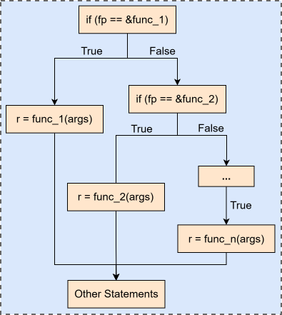

*Figure 3. Expansion of an indirect call.*

In this example, `HealthAndArmingChecks::update()` iterates over the `_checks` array and makes the following indirect call.

```cpp
_checks[i]->checkAndReport(_context, _reporter)
```

The candidate targets at this call site include the following.

```text
{
    RcAndDataLinkChecks::checkAndReport,
    ManualControlChecks::checkAndReport,
    ...,
    RcCalibrationChecks::checkAndReport,
    ...
}
```

The following pseudocode illustrates the expansion in [Figure 3](#figure-3) using the addresses of the receiver objects.

```cpp
auto *check = _checks[i]

if (check == &_rc_and_data_link_checks) {
    _rc_and_data_link_checks.RcAndDataLinkChecks::checkAndReport(_context, _reporter)
} else if (check == &_manual_control_checks) {
    _manual_control_checks.ManualControlChecks::checkAndReport(_context, _reporter)
}
// ...
else if (check == &_rc_calibration_checks) {
    _rc_calibration_checks.RcCalibrationChecks::checkAndReport(_context, _reporter)
}
// ...
```

### Bounded function inlining

RVat starts at $e_F$ and inlines callees up to the maximum inlining depth $D_{\max}$. 
[Figure 4](#figure-4) shows one inlining step. RVat copies the callee's CFG at the call site and binds the actual arguments $\mathrm{val}_i$ to the corresponding formal parameters $\mathrm{arg}_i$. 
It redirects the callee's exit path to the caller's successor block and assigns the return value `ret` to `a` on that path. 
The new CFG replaces the original call and return nodes with the copied instructions and the connecting edges. 
In the figure, the callee's local variable `ret` becomes the global variable `callee_ret_1`, where `callee` abbreviates the mangled function name and `1` identifies the inlined copy.

<a id="figure-4"></a>

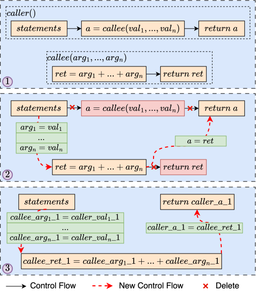

*Figure 4. Function inlining at a single call site.*

[Figure 5](#figure-5) and [Figure 6](#figure-6) show the normalized CFGs of the caller and the callee. 
Each loop in [Figure 5](#figure-5) has a direct call to `RcAndDataLinkChecks::checkAndReport()` on the corresponding dispatch branch. 
Both calls are at depth 1 and are therefore inlined with the illustrative setting $D_{\max}=1$.

<a id="figure-5"></a>

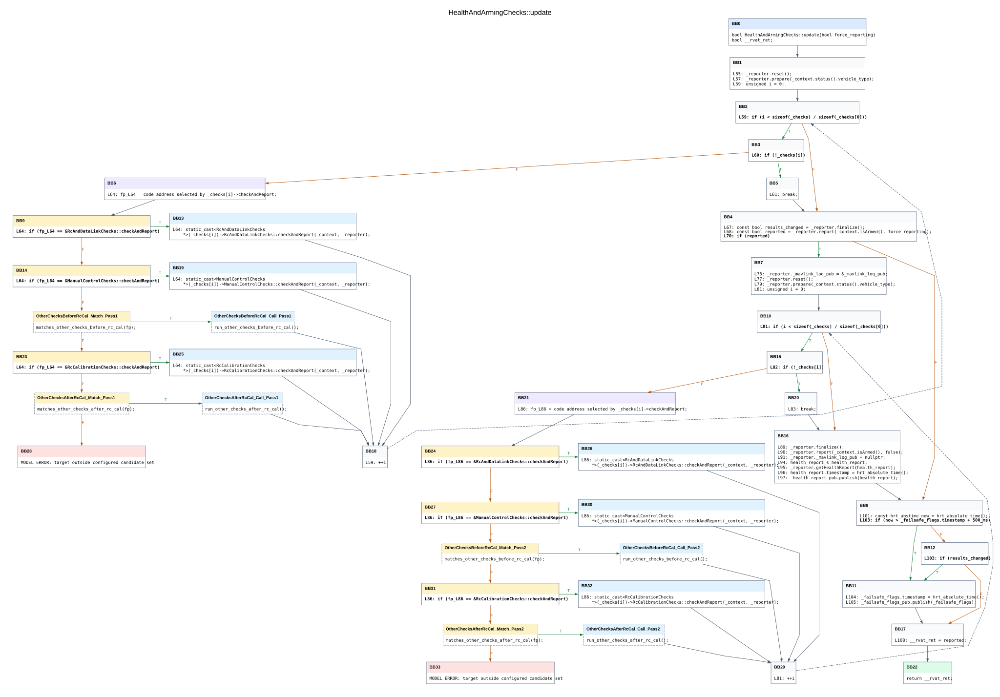

*Figure 5. CFG of HealthAndArmingChecks::update() after normalization.*

<a id="figure-6"></a>

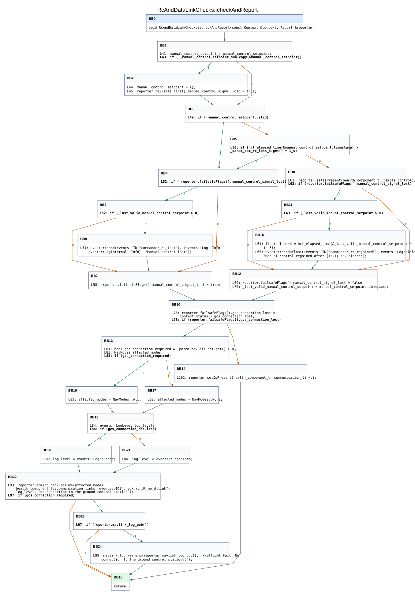

*Figure 6. CFG of RcAndDataLinkChecks::checkAndReport() after normalization.*

[Figure 7](#figure-7) outlines the two inlined copies of the RC check in red.
In each copy, RVat binds the receiver `_checks[i]` to `this` and passes `_context` and `_reporter` by reference to `context` and `reporter`. 
Since `checkAndReport()` returns `void`, the callee's exit path flows directly to the `++i` block of the corresponding loop. 
Calls inside the inlined copies that exceed $D_{\max}$ remain external calls. 
The depth limit therefore determines which callee bodies appear explicitly in the TCFA.

RVat globalizes each local variable under a name of the form `[mangled_func]_[var]_[copy_id]`. 
For example, the two copies of `elapsed` appear as `_ZN19RcAndDataLinkChecks14checkAndReportERK7ContextR6Report_elapsed_1` and `_ZN19RcAndDataLinkChecks14checkAndReportERK7ContextR6Report_elapsed_2`. 
These names distinguish the variables of the two copies. 
Member accesses through the bound `this` pointer still refer to the original object.

<a id="figure-7"></a>

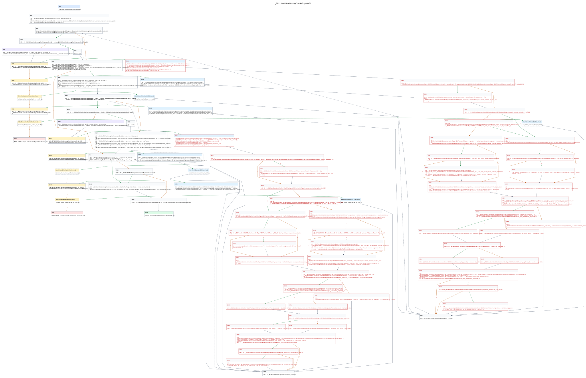

*Figure 7. Inlining and variable globalization in HealthAndArmingChecks::update().*

### Separating instructions from branch decisions

RVat moves each conditional branch instruction at the end of a basic block into a separate conditional-branch basic block (CBB). 
In [Figure 8](#figure-8), the instructions that precede `if (x >= y)` remain in the original block.
Control passes from that block to the CBB and then follows the original true or false successor. 
This separation lets the TCFA execute the preceding instructions on one transition and test the resulting data valuation on the outgoing transitions of the CBB.

<a id="figure-8"></a>

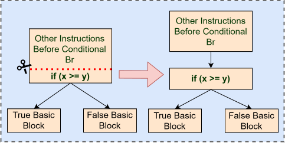

*Figure 8. Separation of a conditional branch into a CBB.*

[Figure 9](#figure-9) applies this transformation to both inlined copies.

<a id="figure-9"></a>

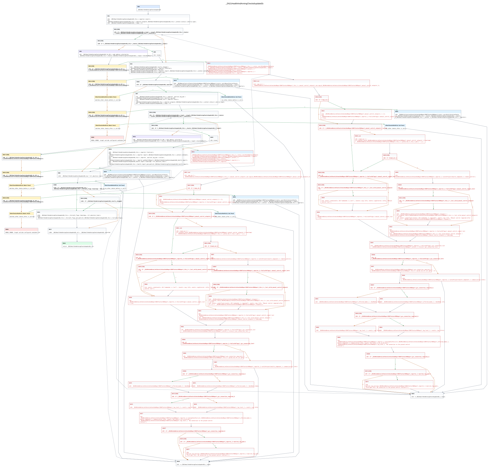

*Figure 9. Inlined CFG of HealthAndArmingChecks::update() after separation of conditional branches.*

### Mapping CFG elements to the TCFA

RVat maps each basic block $b$ to a location $\ell_b$ and each CFG edge $(b,b')$ to a transition $(\ell_b,\sigma,g,R,\ell_{b'})$.
 The guard $g=\phi\land\psi$ combines a time constraint $\phi$ and a data constraint $\psi$. 
 [Table 2](#table-2) shows how the source block determines the instruction sequence and the data constraint.

<a id="table-2"></a>

**Table 2. Mapping from the normalized CFG to the time-unspecified TCFA**

| CFG element | TCFA element |
|---|---|
| Basic block $b$ | Location $\ell_b$ |
| Entry block $b_0$ | Initial location $\ell_{b_0}$ |
| Edge $(b,b')$ | Transition from $\ell_b$ to $\ell_{b'}$ |
| Outgoing edge of an ordinary basic block | $\sigma$ is the source block's instruction sequence and $\psi=\mathrm{true}$ |
| Outgoing edge of a CBB | $\sigma=\emptyset$. For the true edge, $\psi$ is the branch condition. For the false edge, $\psi$ is its negation. |

[Figure 10](#figure-10) illustrates the mapping with four blocks. `BB1`, `BB2` (a CBB), `BB3`, and `BB4` become `init`, $L_2$, $L_3$, and $L_r$, respectively. 
The transition from `init` to $L_2$ executes `x = 0`. 
The two transitions from $L_2$ have empty instruction sequences and carry the data constraints `x >= y` and `x < y`. 
The transition from $L_3$ to $L_r$ executes `x = y - 1` followed by `y = x * 10`. 

<a id="figure-10"></a>

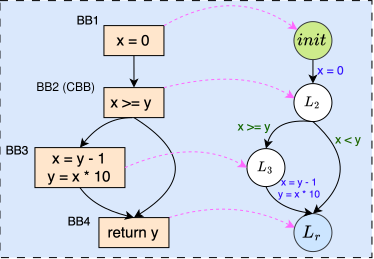

*Figure 10. Mapping a normalized CFG to a time-unspecified TCFA.*

[Figure 11](#figure-11) shows the time-unspecified TCFA obtained by applying the same mapping rules to the CFG in [Figure 9](#figure-9).

<a id="figure-11"></a>

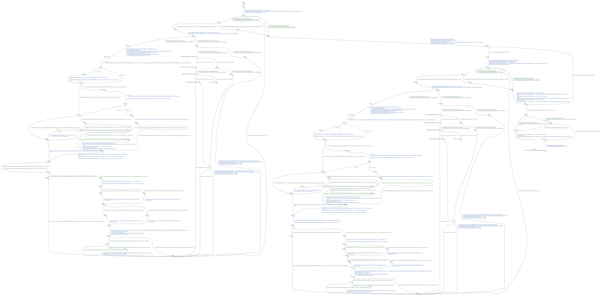

*Figure 11. Time-unspecified TCFA of HealthAndArmingChecks::update().*

In [Figure 10](#figure-10) and [Figure 11](#figure-11), green labels show the data constraints $\psi$ and blue labels show the instruction sequences $\sigma$. 
At this stage every transition has $\phi=\mathrm{true}$ and $R=\emptyset$, so the figures omit these labels. 
In the subsequent timing stage, RVat uses execution time bounds estimated from hardware measurements to set the time constraints on transitions and the clock invariants on locations.

### Adding timing constraints

RVat incorporates the estimated execution-time bounds into the time-unspecified TCFA by adding transition guards, location invariants, and clock resets. The BCET specifies the earliest time at which a transition may execute its instruction sequence, whereas the WCET limits the time spent at the source location. Together, these constraints restrict the modeled execution time of the instruction sequence to the estimated interval.

To illustrate this step, consider the time-unspecified TCFA in [Figure 10](#figure-10) and suppose that the execution-time intervals for `x = 0` and `x = y - 1; y = x * 10` are $[1,2]$ and $[2,4]$ time units, respectively. [Figure 12](#figure-12) shows the resulting TCFA with timing constraints. For this example, the clock set is $C=\{t,T_{global}\}$, with both clocks initialized to zero. The local clock $t$ measures the time spent at each location and is reset on every transition. The global clock $T_{global}$ advances continuously and is never reset, so each transition has $R=\{t\}$ and leaves $T_{global}$ unchanged.

<a id="figure-12"></a>

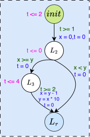

*Figure 12. TCFA obtained by adding timing constraints to the automaton in Figure 10.*

As shown in [Figure 12](#figure-12), the transition from `init` to $L_2$ is assigned the time constraint $\phi=(t\geq 1)$, and its source location receives the invariant $I(\mathrm{init})=(t\leq 2)$. 
Since the original data constraint is $\psi=\mathrm{true}$, the resulting guard is simply $g=(t\geq 1)$. 
The transition therefore executes `x = 0` after between one and two time units at `init` and resets $t$ to zero, represented by the reset set $R=\{t\}$.

Similarly, the transition from $L_3$ to $L_r$ is assigned the time constraint $\phi=(t\geq 2)$ and the reset set $R=\{t\}$, while $L_3$ receives the invariant $I(L_3)=(t\leq 4)$. 
The clock is reset on the incoming transition from $L_2$ to $L_3$, so these bounds measure the time spent at $L_3$. 
Upon taking the outgoing transition, the model executes `x = y - 1` followed by `y = x * 10` and resets $t$.

Both clocks increase by the same amount during a time elapse. For example, if the transition from `init` to $L_2$ occurs after $\delta \in [1,2]$ time units, then immediately after the transition $t=0$ and $T_{global}=\delta$. Along a path with successive delays $\delta_1,\ldots,\delta_k$, the global clock records $T_{global}=\sum_{i=1}^{k}\delta_i$, including time accumulated before each reset of $t$. This accumulated time connects the basic-block timing constraints to policy-level timing requirements, such as a deadline $T_{global}\leq T_{max}$. Figure 12 shows the local timing constraints and resets; the non-resetting global clock is implicit.
