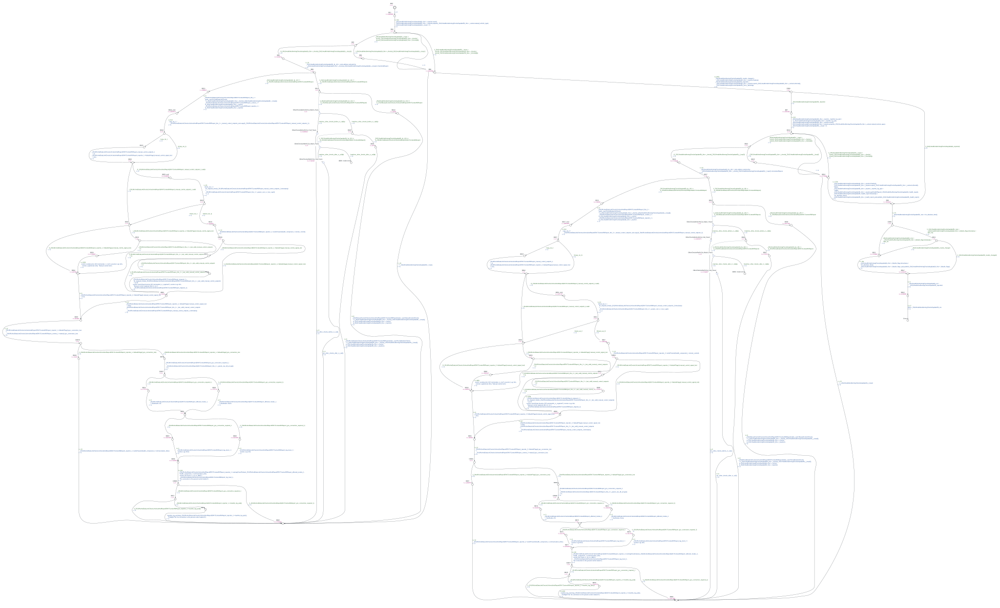

# Running Example

For `PX_RCFS_P1`, RVat derives slicing criteria from the Policy–TCTL correspondence and uses them to extract a function-level slice. It then converts the slice into a timed control flow automaton (TCFA) before adding time constraints.

## From the Policy–TCTL correspondence to slicing criteria

**Policy.** As long as the physical radio control (RC) link remains healthy, the drone should not enter RC failsafe solely because the update interval of `manual_control_setpoint` exceeds `COM_RC_LOSS_T`.

The corresponding TCTL formula is written in UPPAAL syntax.

```text
A[] ((rc_link_ok && rc_update_time > COM_RC_LOSS_T) imply !rc_loss_failsafe)
```

The formula requires that rc_loss_failsafe be false in every reachable state where the physical link is healthy and the RC update interval exceeds the threshold.
To derive slicing criteria, RVat uses retrieval-augmented generation (RAG) to retrieve function definitions relevant to the policy and propose mappings from the formula to source code.
Each criterion is a pair \((var, loc)\) that identifies a program variable and its source location.
[Table 1](#table-1) maps the formula variables to the slicing criteria.

<a id="table-1"></a>

**Table 1. Mapping from formula variables to slicing criteria**

| Formula variable | Slicing criterion `(var, loc)` |
|---|---|
| `rc_link_ok` | (`manual_control_setpoint.valid`, `rcAndDataLinkCheck.cpp:49`) |
| `COM_RC_LOSS_T` | (`_param_com_rc_loss_t.get()`, `rcAndDataLinkCheck.cpp:50`) |
| `rc_loss_failsafe` | (`reporter.failsafeFlags().manual_control_signal_lost`, `rcAndDataLinkCheck.cpp:58`) |

`rc_update_time` is the global clock `T_global`, which tracks the total elapsed time of the modeled execution.

## From slicing criteria to a function-level slice

RVat constructs the program dependence graph (PDG) of the entire autopilot with LLVM-PDG and uses MLTA to refine the resolution of indirect and virtual calls in LLVM IR.
[Figure 1](#figure-1) shows the part of the PDG needed to explain the slice.
It expands the dependencies within `RcAndDataLinkChecks::checkAndReport()` and summarizes the caller, `HealthAndArmingChecks::update()`, in a single node.
The edges that bind the actual arguments at the call site to the callee's parameters remain visible.

<a id="figure-1"></a>


*Figure 1. Program dependence graph and backward slicing for PX_RCFS_P1.*

The three criteria (`_param_com_rc_loss_t.get()`, `rcAndDataLinkCheck.cpp:50`), (`reporter.failsafeFlags().manual_control_signal_lost`, `rcAndDataLinkCheck.cpp:58`), and (`manual_control_setpoint.valid`, `rcAndDataLinkCheck.cpp:49`) map to the red boxes labeled SC1, SC2, and SC3, respectively. These three PDG nodes form $S_p=\{\mathrm{SC1},\mathrm{SC2},\mathrm{SC3}\}$.
RVat traverses the data and control dependence edges backward from $S_p$ and adds the nodes that affect the starting nodes to the slice. 
In [Figure 1](#figure-1), orange nodes and red edges show the traversal. 
Solid edges indicate data dependences or parameter bindings, and dashed edges indicate control dependences. 
When the traversal reaches the `this` parameter of `checkAndReport()`, it continues back to `HealthAndArmingChecks::update()` through the parameter binding at the call site.

RVat collects the functions that contain these nodes and the relevant call relationships to obtain the function-level slice $F$, with `HealthAndArmingChecks::update()` as its entry function $e_F$. 
The slice serves as input to TCFA construction.

## From the slice to a time-unspecified TCFA

### Control flow graph normalization

To construct the TCFA from the slice, RVat adapts the program to the restrictions of the automaton model. Specifically, CFG normalization eliminates multiple exit points and indirect branches in two steps.

First, RVat consolidates each function's multiple return points into a single exit basic block. In [Figure 2](#figure-2), the two original execution paths return `true` and `false`, respectively. After normalization, each path assigns its return value to `ret` and flows into a common block that executes `return ret`. This gives the inlining step a single exit to reconnect to the caller.

<a id="figure-2"></a>


*Figure 2. Return unification.*

Second, RVat eliminates indirect calls by transforming them into explicit branching structures using candidate target functions resolved by MLTA. In [Figure 3](#figure-3), RVat replaces the indirect call `r = fp(args)` with conditional branches that compare the function pointer `fp` with each candidate function address in turn. If `fp` matches the address of `func_i`, the corresponding branch executes the direct call `r = func_i(args)`. Otherwise, execution proceeds to the next candidate comparison. The direct call uses the original arguments `args` and stores the return value in `r`. Control then continues with the statements after the original call.

<a id="figure-3"></a>


*Figure 3. Expansion of an indirect call.*

In `HealthAndArmingChecks::update()`, each loop iterates over the `_checks` array and makes the indirect call `_checks[i]->checkAndReport(_context, _reporter)`. MLTA resolves 28 candidate targets for this call site, including `RcAndDataLinkChecks`, `ManualControlChecks`, and `RcCalibrationChecks`. RVat replaces this indirect call with conditional branches comparing the function pointer `fp` against each candidate address:

```cpp
if (fp == &RcAndDataLinkChecks::checkAndReport) {
    _rc_and_data_link_checks.RcAndDataLinkChecks::checkAndReport(_context, _reporter);
} else if (fp == &ManualControlChecks::checkAndReport) {
    _manual_control_checks.ManualControlChecks::checkAndReport(_context, _reporter);
}
// ...
else if (fp == &RcCalibrationChecks::checkAndReport) {
    _rc_calibration_checks.RcCalibrationChecks::checkAndReport(_context, _reporter);
}
// ...
```

Applying these normalization steps yields the CFGs in [Figure 4](#figure-4) and [Figure 5](#figure-5). For presentation clarity, Figure 4 focuses on `RcAndDataLinkChecks::checkAndReport()` and condenses the remaining candidates into summary nodes with dashed outlines. [Figure 5](#figure-5) shows the normalized CFG of `RcAndDataLinkChecks::checkAndReport()`. Subsequent transformations directly inherit this compact representation.

<a id="figure-4"></a>


*Figure 4. CFG of HealthAndArmingChecks::update() after normalization.*

<a id="figure-5"></a>


*Figure 5. CFG of RcAndDataLinkChecks::checkAndReport() after normalization.*

### Bounded function inlining

Because the TCFA has no call stack, RVat performs bounded function inlining to eliminate return edges and construct a flat automaton. Starting from the entry function $e_F$ (`HealthAndArmingChecks::update()`), RVat inlines callee bodies at each call site up to a maximum inlining depth $D_{\max}$. Callees exceeding this depth are treated as external functions.

[Figure 6](#figure-6) illustrates one inlining step at a single call site. RVat copies the callee's CFG at the call site and binds the actual arguments $\mathrm{val}_i$ to the corresponding formal parameters $\mathrm{arg}_i$. 
It redirects the callee's exit path to the caller's successor block and assigns the return value `ret` to `a` on that path. 
The new CFG replaces the original call and return nodes with the copied instructions and the connecting edges. 
In the figure, the callee's local variable `ret` becomes the global variable `callee_ret_1`, where `callee` abbreviates the mangled function name and `1` is an instance index distinguishing copies inlined at different call sites.

<a id="figure-6"></a>


*Figure 6. Function inlining at a single call site.*

Applying this inlining procedure to the running example, RVat traverses the caller CFG in [Figure 4](#figure-4). In [Figure 4](#figure-4), each loop contains a call to `RcAndDataLinkChecks::checkAndReport()` on the corresponding dispatch branch. Because both calls are at depth 1, they are inlined under $D_{\max}=1$ by substituting the callee body from [Figure 5](#figure-5) into the call sites. Other checks and nested calls exceeding $D_{\max}$ are retained as explicit or summary call nodes. [Figure 7](#figure-7) shows the resulting inlined CFG, highlighting the two inlined copies in red, where RVat binds the receiver `_checks[i]` to `this` and passes `_context` and `_reporter` by reference.

To distinguish variables across multiple inlined copies, RVat globalizes local variables using the scheme shown in [Figure 6](#figure-6). Specifically, it prefixes each local variable with its mangled function name and appends a copy identifier. For example, the local variable `elapsed` in the two copies becomes `_ZN19RcAndDataLinkChecks14checkAndReportERK7ContextR6Report_elapsed_1` and `_ZN19RcAndDataLinkChecks14checkAndReportERK7ContextR6Report_elapsed_2`, respectively. Member accesses through the bound `this` pointer continue to refer to the original object.

<a id="figure-7"></a>


*Figure 7. Partial illustration of inlining and variable globalization in HealthAndArmingChecks::update().*

### Separating conditional-branch instructions into CBBs

Before constructing the time-unspecified TCFA, RVat transforms the inlined CFG by separating each conditional-branch instruction from the end of a basic block into an independent conditional-branch basic block (CBB).

[Figure 8](#figure-8) illustrates this transformation on a single basic block. The instruction `x = 0` remains in `BB1`, while the conditional-branch instruction `if (x >= y)` is moved into `BB2 (CBB)`. Control passes from `BB1` to `BB2`, and then follows the original true or false successor (`BB3` or `BB4`).

<a id="figure-8"></a>


*Figure 8. Separation of a conditional branch into a CBB.*

[Figure 9](#figure-9) shows the resulting CFG after applying this transformation to the inlined CFG in [Figure 7](#figure-7), where each conditional branch across the caller and the two inlined copies is separated into a dedicated CBB.

<a id="figure-9"></a>


*Figure 9. Inlined CFG of HealthAndArmingChecks::update() after separating conditional branches into CBBs.*

### Mapping CFG elements to the TCFA

RVat maps each basic block $b$ to a location $\ell_b$ and each CFG edge $(b,b')$ to a transition $(\ell_b,\sigma,g,R,\ell_{b'})$. The guard $g=\phi\land\psi$ combines a time constraint $\phi$ and a data constraint $\psi$. At this stage, the time constraint is initialized to $\phi = \mathrm{true}$ and the clock reset set to $R = \emptyset$. [Table 2](#table-2) summarizes the mapping from CFG elements to the time-unspecified TCFA.

<a id="table-2"></a>

**Table 2. Mapping from the normalized CFG to the time-unspecified TCFA**

| CFG element | TCFA element |
|---|---|
| Basic block $b$ | Location $\ell_b$ |
| Entry block $b_0$ | Initial location $\ell_{b_0}$ |
| Edge $(b,b')$ | Transition from $\ell_b$ to $\ell_{b'}$ |
| Outgoing edge of an ordinary basic block | $\sigma$ is the source block's instruction sequence and $\psi=\mathrm{true}$ |
| Outgoing edge of a CBB | $\sigma=\emptyset$. For the true edge, $\psi$ is the branch condition. For the false edge, $\psi$ is its negation. |

[Figure 10](#figure-10) illustrates the mapping with four blocks. `BB1`, `BB2` (a CBB), `BB3`, and `BB4` become `init`, $L_2$, $L_3$, and $L_r$, respectively. 
The transition from `init` to $L_2$ executes `x = 0`. 
The two transitions from $L_2$ have empty instruction sequences and carry the data constraints `x >= y` and `x < y`. 
The transition from $L_3$ to $L_r$ executes `x = y - 1` followed by `y = x * 10`. On transitions, green labels show the data constraints $\psi$ and blue labels show the instruction sequences $\sigma$. At this stage, every transition has $\phi=\mathrm{true}$ and $R=\emptyset$, so the figures omit these labels.

<a id="figure-10"></a>


*Figure 10. Mapping a normalized CFG to a time-unspecified TCFA.*

Applying the mapping rules in [Table 2](#table-2) to the CFG of `HealthAndArmingChecks::update()` in [Figure 9](#figure-9) produces the time-unspecified TCFA shown in [Figure 11](#figure-11). Each basic block and CBB corresponds to an automaton location, while the edges become transitions labeled with their respective instruction sequences and branch conditions.

<a id="figure-11"></a>


*Figure 11. Time-unspecified TCFA of HealthAndArmingChecks::update().*

### Adding timing constraints

RVat incorporates the estimated execution-time bounds into the time-unspecified TCFA by adding transition guards, location invariants, and clock resets. The BCET specifies the earliest time at which a transition may execute its instruction sequence, whereas the WCET limits the time spent at the source location. Together, these constraints restrict the modeled execution time of the instruction sequence to the estimated interval.

To illustrate this step, consider the time-unspecified TCFA in [Figure 10](#figure-10) and suppose that the execution-time intervals for `x = 0` and `x = y - 1; y = x * 10` are $[1,2]$ and $[2,4]$ time units, respectively. [Figure 12](#figure-12) shows the resulting TCFA with timing constraints. For this example, the clock set is $C=\{t,T_{global}\}$, with both clocks initialized to zero. The local clock $t$ measures the time spent at each location and is reset on every transition. The global clock $T_{global}$ advances continuously and is never reset, so each transition has $R=\{t\}$ and leaves $T_{global}$ unchanged.

<a id="figure-12"></a>


*Figure 12. TCFA obtained by adding timing constraints to the automaton in Figure 10.*

As shown in [Figure 12](#figure-12), the transition from `init` to $L_2$ is assigned the time constraint $\phi=(t\geq 1)$, and its source location receives the invariant $I(\mathrm{init})=(t\leq 2)$. 
Since the original data constraint is $\psi=\mathrm{true}$, the resulting guard is simply $g=(t\geq 1)$. 
The transition therefore executes `x = 0` after between one and two time units at `init` and resets $t$ to zero, represented by the reset set $R=\{t\}$.

Since the outgoing transitions of the CBB location $L_2$ have $\sigma=\emptyset$, we prevent time elapse at $L_2$ by adding the invariant $I(L_2)=(t\leq0)$. The incoming transition resets $t$ to zero.

Similarly, the transition from $L_3$ to $L_r$ is assigned the time constraint $\phi=(t\geq 2)$ and the reset set $R=\{t\}$, while $L_3$ receives the invariant $I(L_3)=(t\leq 4)$. 
The clock is reset on the incoming transition from $L_2$ to $L_3$, so these bounds measure the time spent at $L_3$. 
Upon taking the outgoing transition, the model executes `x = y - 1` followed by `y = x * 10` and resets $t$.

Both clocks increase by the same amount during a time elapse. For example, if the transition from `init` to $L_2$ occurs after $\delta \in [1,2]$ time units, then immediately after the transition $t=0$ and $T_{global}=\delta$. Along a path with successive delays $\delta_1,\ldots,\delta_k$, the global clock records $T_{global}=\sum_{i=1}^{k}\delta_i$, including time accumulated before each reset of $t$. This accumulated time connects the basic-block timing constraints to policy-level timing requirements, such as a deadline $T_{global}\leq T_{max}$. Figure 12 shows the local timing constraints and resets; the non-resetting global clock is implicit.

[Figure 13](#figure-13) shows the result of applying the timing constraints to [Figure 11](#figure-11). The time unit for this model is 1 ns.

<a id="figure-13"></a>



*Figure 13. TCFA of HealthAndArmingChecks::update() with timing constraints.*


<!--
**可以把 $T_{\mathrm{global}}$ 在模型入口设为 0，也可以用相对时间抽象 PX4 的时间函数。** 这里要分开两个量，即**模型已经跑了多久**，以及**最近一条 RC 消息已经多久没更新**。

设 $a_0$ 是模型启动时，最近一条 RC 消息已经过去的时间。只要到检查点为止都没有新消息刷新时间戳，就有

$$
\text{检查时的消息年龄} = a_0 + T_{\mathrm{global}}.
$$

- **模型恰好从消息时间戳对应的时刻开始**，则 $a_0=0$，可以直接用 $T_{\mathrm{global}}$ 表示消息年龄。
- **模型从更晚的时刻开始**，$T_{\mathrm{global}}$ 仍然可以从 0 开始。因为 $a_0\ge 0$，只要 $T_{\mathrm{global}}$ 本身已经超过阈值，就足以判定这条路径上消息超时。例如阈值是 100 ms，模型内已经过了 110 ms，消息就至少有 110 ms 没更新。反过来，模型内只过了 80 ms，消息也可能因为初始时已有 30 ms 的年龄而超时。

如果你只想找**一条反例**，可以先不单独建模 $a_0$。在同一条消息未刷新的前提下，找一条可达路径，使 $T_{\mathrm{global}}$ 超过阈值时，物理 RC 链路仍然正常，且 RC failsafe 已触发。接近 WCET 的耗时解释的是**模型运行期间累计的这段时间为何可能足够长**，和消息在模型启动前已经过去多久是两个问题。
-->


<!-- 
如何抽象源码中的时间调用，在不向外部函数传递 UPPAAL 时钟的情况下，探索不同分支并检查时间相关属性？

    考虑到 lli 仅负责解释执行 LLVM IR，无法获知目标机上的准确执行时间，且 UPPAAL 的时钟变量不支持作为普通数据变量按值传递给外部函数，lli 在执行 get_time()、hrt_elapsed_time() 等时间调用时无法获取精确的当前时间戳。为此，RVat 在 lli 执行这类外部调用时，依据函数返回类型显式枚举其合法最小值和最大值作为候选返回值，并通过外部调用接口回写至 TCFA 的数据变量，以此触发源码中依赖该返回值的不同控制流分支。TCFA 中的时间流逝则受 TCFA 的时钟约束控制，policy对应的 TCTL 公式中的时间条件中的时间条件通过全局时钟 T_global 检查。
-->
